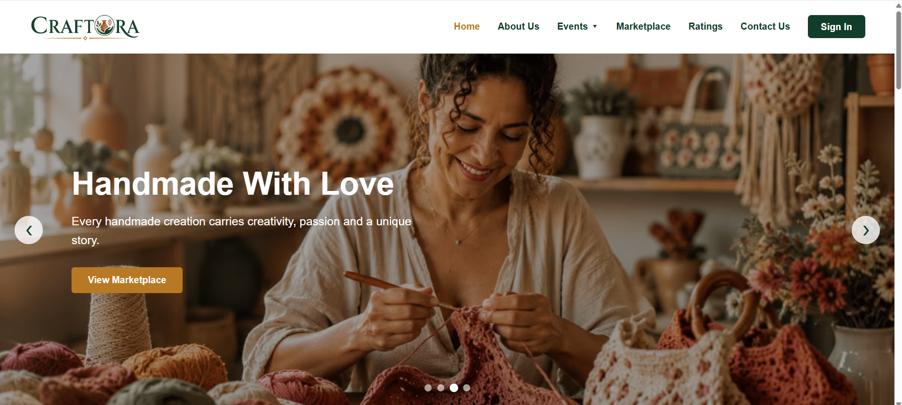
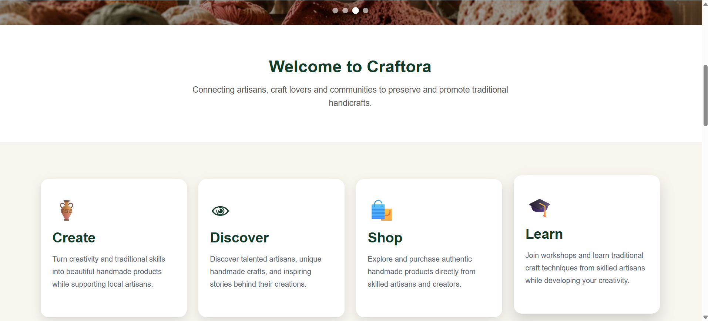
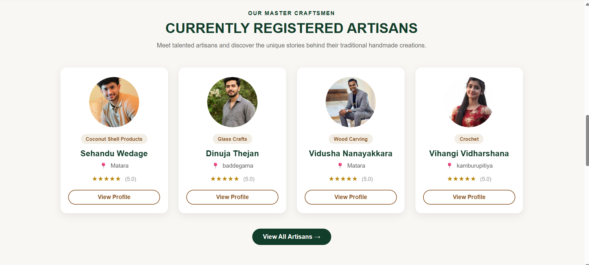
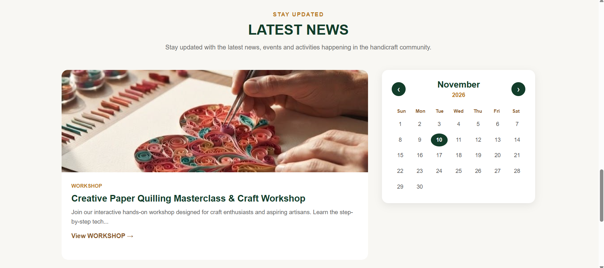
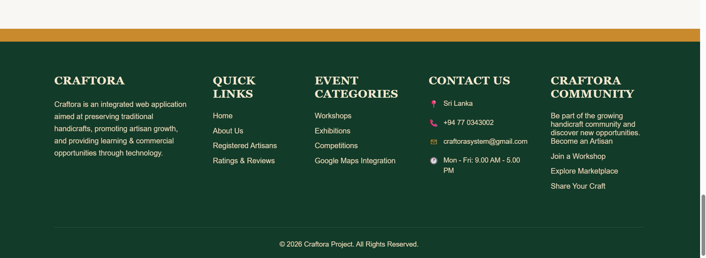
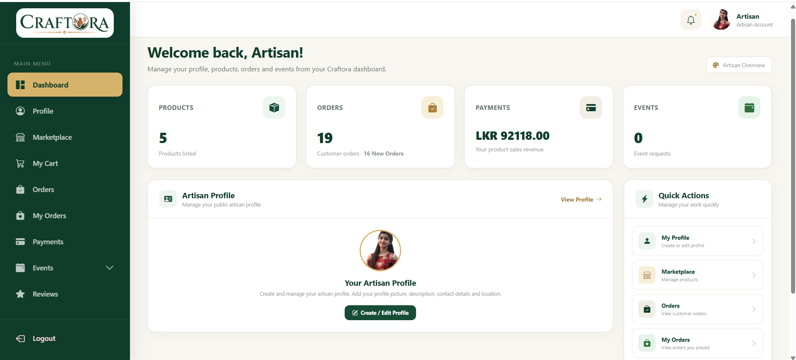
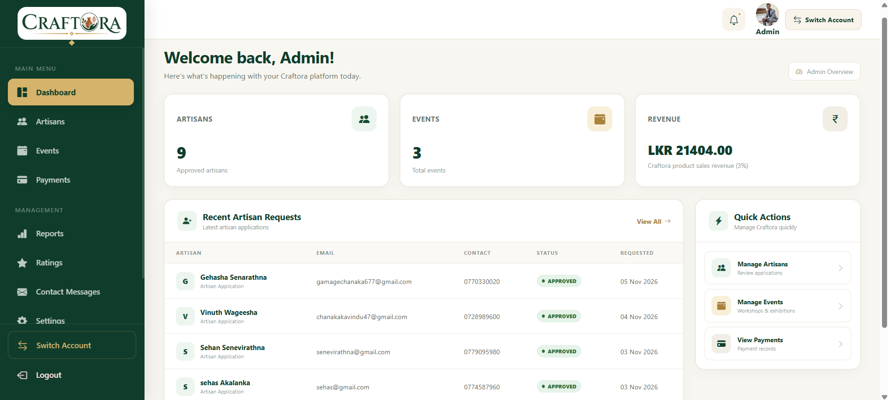
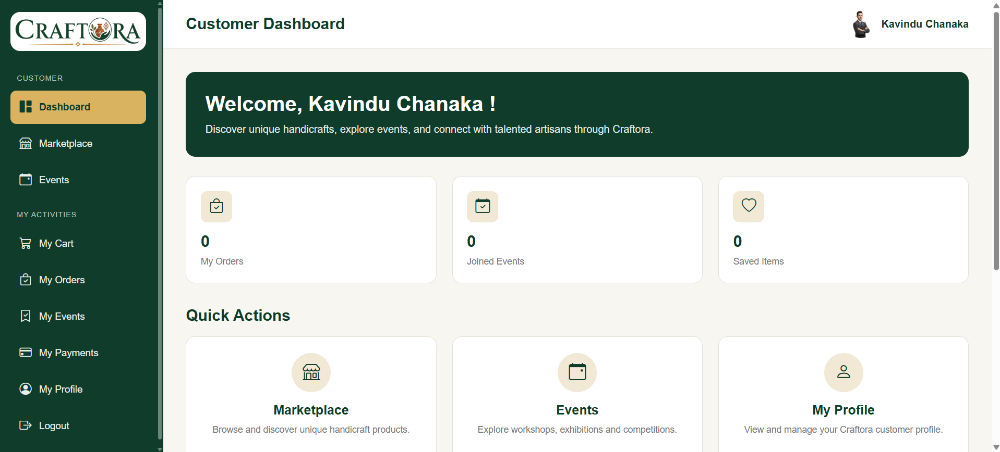
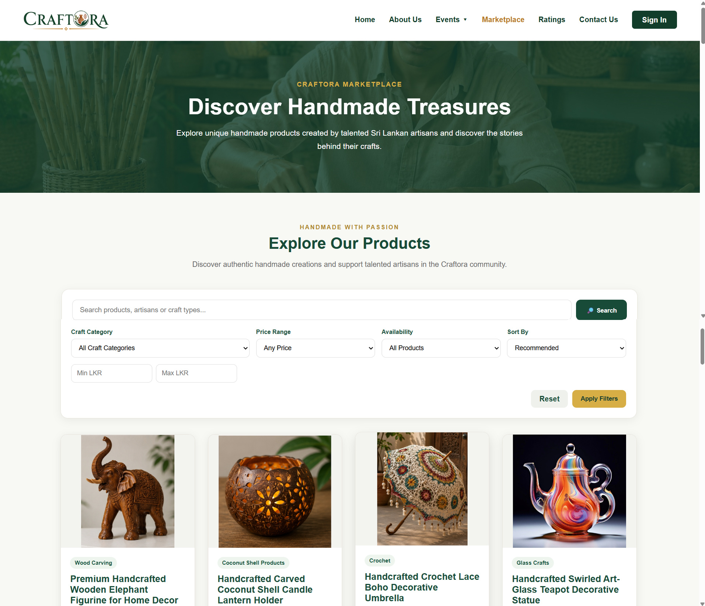

# Craftora – Handicraft Development and Community Management System

Craftora is a web-based platform designed to connect artisans, customers, and learners through a digital handicraft marketplace and community management system.

## Project Overview

Craftora provides a centralized platform for artisans to showcase and sell handmade products, organize workshops and exhibitions, manage event registrations, and interact with customers.

## User Roles

- **Administrator:** Manages users, artisan approvals, products, events, payments, reports, and platform settings.
- **Artisan:** Manages profiles, products, orders, workshops, exhibitions, and customer reviews.
- **Customer / Learner:** Browses products, purchases handicrafts, registers for events, and submits ratings and reviews.

## Main Features

- User registration and role-based login
- Artisan registration and approval
- Product and marketplace management
- Shopping cart and order management
- PayHere payment integration (Sandbox)
- Workshop, exhibition, and competition management
- Event registration and payment management
- Event attendance and certificate management
- Product ratings and reviews
- Review reporting and moderation
- Admin dashboard and platform settings
- Event discussions and notifications

## Technologies Used

| Category | Technologies |
|---|---|
| Frontend | HTML, CSS, Bootstrap, JavaScript |
| Backend | Java, Spring Boot |
| Database | MySQL |
| IDE | Eclipse IDE, Visual Studio Code |
| Database Tool | MySQL Workbench |
| Version Control | Git, GitHub |
| Integrations | Google Maps API, PayHere Sandbox |

## Project Structure

```text
Craftora/
├── src/
│   ├── main/
│   │   ├── java/
│   │   └── resources/
│   │       ├── static/
│   │       └── templates/
│   └── test/
├── pom.xml
├── mvnw
├── mvnw.cmd
└── README.md
```

## Installation and Setup

### Prerequisites

- Java JDK
- MySQL Server
- Maven

### 1. Clone the Repository

```bash
git clone https://github.com/kavindyachathurangi2002/Craftora.git
```

### 2. Open the Project

Open the project using Eclipse IDE or Visual Studio Code.

### 3. Configure the Database

Create a MySQL database for Craftora.

Configure your local `application.properties` file with your database connection details and required application settings.

**Important:** Keep passwords, API keys, and other sensitive credentials private. Do not upload them to GitHub.

### 4. Run the Application

Run the Spring Boot application from your IDE or use:

```bash
mvn spring-boot:run
```

### 5. Access the Application

Open your browser and visit:

```text
http://localhost:8080
```

## Developer

Developed as a Final Year Undergraduate Project.

**GitHub:** [kavindyachathurangi2002](https://github.com/kavindyachathurangi2002)

**Repository:** [Craftora](https://github.com/kavindyachathurangi2002/Craftora)

---

*Craftora – Empowering Artisans Through Technology.*


## System Screenshots

### Home Page – Main Banner



### Welcome and Services



### Registered Artisans



### Latest News and Calendar



### Home Page Footer



### Artisan Dashboard

The Artisan Dashboard provides an overview of products, customer orders, payments, events, and quick management actions.




### Admin Dashboard

The Admin Dashboard provides a centralized interface to manage users, artisans, products, events, payments, and platform activities.




### Customer Dashboard

The Customer Dashboard provides customers with a user-friendly interface to explore handmade products, manage shopping carts and orders, register for events, view payments, and manage their profiles.




## Marketplace

The Craftora Marketplace allows customers to explore and discover handmade products created by talented artisans.

### Marketplace Features

- Browse handmade products from different artisans.
- Search products by name, artisan, or craft type.
- Filter products by craft category and price range.
- Check product availability.
- Sort products based on recommendations.
- View product details and discover unique handicrafts.

### Marketplace Overview


